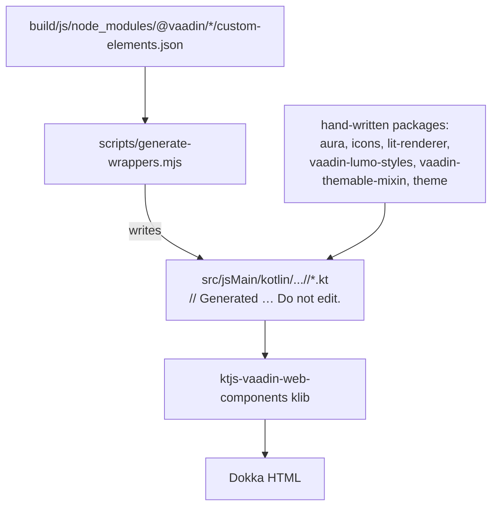

# API reference and sources

The published Dokka output lives at
[shijianjs.github.io/ktjs-vaadin/api/](https://shijianjs.github.io/ktjs-vaadin/api/); it is generated
from the annotated sources, so it always matches what Maven Central serves.

## Generated versus hand-written



- Generated files start with `// Generated by scripts/generate-wrappers.mjs. Do not edit.` and are
  deleted and rewritten on every run.
- Hand-written packages are listed in the generator's `HAND_WRITTEN` set and are never overwritten.
  They exist where the manifest is wrong or too thin: `LoginI18n`, `UploadI18n`, `MenuBarI18n`,
  `DateTimePickerI18n`, `UploadManager` and friends.
- Elements upstream marks `@protected` never reach a manifest, so they get no generated file. The
  ones the docs give a public API ("has the same API as `<vaadin-item>`") are hand-written and their
  tags are listed in the generator's `MANUAL_TAGS`: `MenuBarButtonElement` (a `ButtonElement`
  subclass), `MenuBarItemElement`, `MenuBarListBoxElement`, `MenuBarSubmenuElement`,
  `AvatarGroupMenuElement`, `AvatarGroupMenuItemElement`, `ComboBoxItemElement`,
  `MultiSelectComboBoxItemElement`, `TimePickerItemElement`, `MessageInputButtonElement`,
  `SelectValueButtonElement`. Elements upstream neither documents nor exports (overlays, scrollers,
  bubbles) stay unwrapped.
- Everything the manifest gets right stays generated. Fix the generator, not the output.

## Regenerating after an upstream bump

```bash
# 1. raise the version in package.json
./gradlew kotlinNpmInstall          # install the new packages, refresh custom-elements.json
node scripts/generate-wrappers.mjs  # rewrite the generated packages
./gradlew :ktjs-vaadin-web-components:jsBrowserTest
```

## What the wrapper deliberately does not model

| Gap | Why |
| --- | --- |
| Event `detail` payloads | the manifest does not describe them; 92 hand-written payloads would be guesswork |
| Commercial components | Board, Charts, CRUD, Dashboard, Grid Pro, Map, Rich Text Editor, Spreadsheet are not in the free packages |
| React bindings, `vaadin` / `vaadin-core` meta packages | not wrappers of anything this library exposes |
| `tree-grid` | as of V25 it is a grid tree column plus a data provider, not a custom element |

The repository's
[`TODO.md`](https://github.com/shijianjs/ktjs-vaadin/blob/master/TODO.md) keeps the per-page coverage
table and the list of wrapper bugs found while writing the demo.
