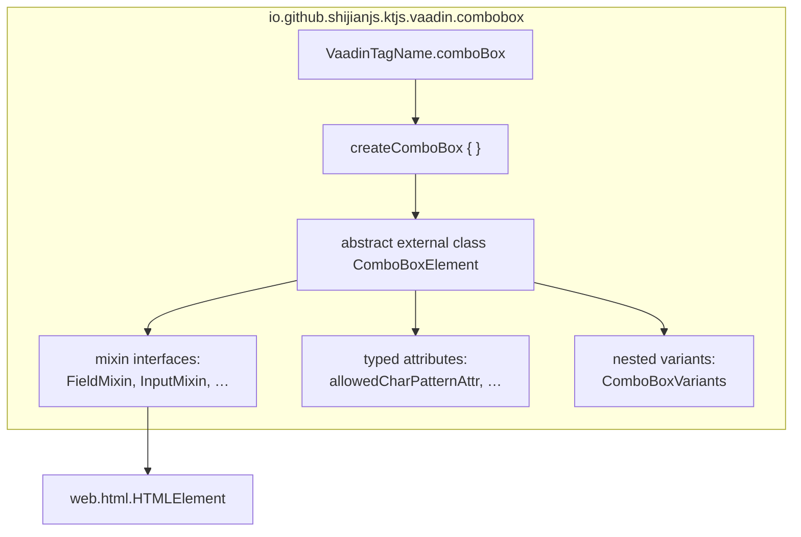

# Components and capabilities

The wrapper follows one layout rule: **one npm package, one Kotlin package**. The npm name loses
`@vaadin/` and `vaadin-`, and hyphens; `@vaadin/combo-box` is `io.github.shijianjs.ktjs.vaadin.combobox`.



## Why mixins are interfaces

Upstream components share behaviour through mixins (`FieldMixin`, `InputMixin`, `ThemePropertyMixin`,
`FocusableMixin` …). Each mixin is an `external interface`, and each element implements every mixin it
inherits. The effect is that a function can ask for the **capability** rather than the component:

```kotlin
import io.github.shijianjs.ktjs.vaadin.fieldbase.FieldMixin

fun labelOf(field: FieldMixin): String = field.label
```

That is the same thing Vaadin Flow does with `HasValue` / `HasLabel`, expressed with interfaces you
already have.

## Typed attributes

Each element file ends with the accessors for its HTML attributes. `Attribute<T>` reads and writes the
attribute and decodes it through a codec, so the type is the one upstream documents:

| Accessor | Type |
| --- | --- |
| `cardTitleAttr` | `Attribute<String>` |
| `titleHeadingLevelAttr` | `Attribute<Int>` |
| `disabledAttr` | `Attribute<Boolean>` |
| `themeAttr` | `TokenListAttribute<ThemeVariant>` |

Use them when the attribute is the state — a `Property` setter and an attribute setter are not
interchangeable: only the attribute is visible in devtools and in server-rendered HTML.

## Variants

`theme="primary small icon"` is a token list whose legal tokens are per component. Each component
package therefore owns its own variant objects, typed as a `sealed external interface` extending the
shared `ThemeVariant`:

```kotlin
import io.github.shijianjs.ktjs.vaadin.button.ButtonVariants
import io.github.shijianjs.ktjs.vaadin.button.createButton
import io.github.shijianjs.ktjs.vaadin.themablemixin.addTheme
import io.github.shijianjs.ktjs.vaadin.themablemixin.hasTheme

val button = createButton()
button.addTheme(ButtonVariants.primary)          // keeps tokens already set
button.removeTheme(ButtonVariants.primary)
check(button.hasTheme(ButtonVariants.small))
```

`addTheme` / `removeTheme` / `hasTheme` / `themes` hang off `ThemePropertyMixin`, not off
`HTMLElement`: only components that actually render the `theme` attribute implement it.

They are shorthand over one accessor, `themeAttr`, a `TokenListAttribute<ThemeVariant>` from
`ktjs-wrapper-kit` with a codec that spells a variant as its `name`. So the attribute object is
usable too — `themeAttr.add(ButtonVariants.primary)`, `themeAttr.tokens = listOf("acme-brand")` — and
`values` (typed) and `tokens` (raw strings) are two views of the same text. Raw tokens survive a typed
`add` / `remove` / `toggle`; only `setTheme(ThemeVariant…)` replaces the whole list.

## Theming: Lumo utility classes

Lumo's [utility classes](https://vaadin.com/docs/latest/styling/lumo/utility-classes) are modelled as
`ClassName` objects, so `padding: LumoUtility.Padding.MEDIUM` is checked instead of typed:

```kotlin
import io.github.shijianjs.ktjs.vaadin.card.createCard
import io.github.shijianjs.ktjs.vaadin.lumoutility.LumoUtility

val card = createCard()
card.classList.add(LumoUtility.Padding.MEDIUM, LumoUtility.Gap.SMALL)
```

`LumoUtility` is a tree of `ClassName` constants that mirrors Flow's `LumoUtility` class one to one, so
`LumoUtility.AlignItems.Breakpoint.Small.CENTER` is `sm:items-center`.

They require `utility.css` on the page (see [Getting started](/guide/getting-started)).

## Events

Event names stay upstream's, and so does the payload type: the manifest does not describe each event's
`detail`, so an event arrives as `web.events.Event` unless the wrapper hand-wrote a payload type. Read
the component's state — `value`, `selected`, `opened`, the native `inputElement.validity` — instead of
the payload when the payload is untyped. Where a typed payload exists (upload, message list), the
demo uses it; the known gaps are listed in the repository's `TODO.md`.

## Where the pages live

Every component is demonstrated in the [demo](https://shijianjs.github.io/ktjs-vaadin/demo/), grouped
the way the upstream documentation is:

| Group | Pages |
| --- | --- |
| Buttons and actions | button, menu-bar |
| Input fields | text-field, text-area, email-field, password-field, number-field, integer-field, custom-field, field-highlighter |
| Selection | checkbox, checkbox-group, radio-group, switch, select, combo-box, multi-select-combo-box, list-box, slider |
| Date and time | date-picker, time-picker, date-time-picker |
| Overlays | dialog, confirm-dialog, notification, popover, tooltip, context-menu, login |
| Data | grid, virtual-list, message-list, message-input, markdown, upload |
| Layout and navigation | app-layout, horizontal-layout, vertical-layout, form-layout, split-layout, scroller, master-detail-layout, card, accordion, details, tabs, tabsheet, side-nav, breadcrumbs |
| Display | avatar, avatar-group, badge, icon, icons, progress-bar |
| Theming | theming |
