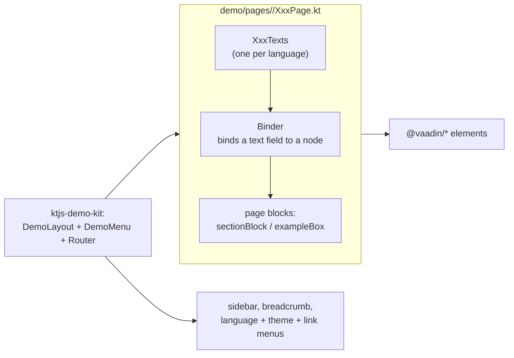
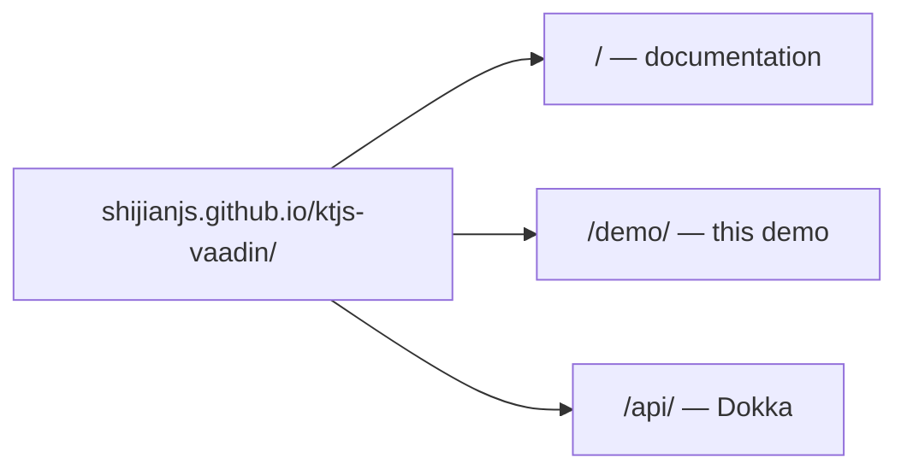

# The demo site

The demo is not a throwaway example page: it is the integration test of this wrapper. Every
component page under `demo/src/jsMain/kotlin/demo/pages/<group>/` mirrors a section of the upstream
documentation and exercises the Kotlin API — if an example cannot be written without a cast, the
wrapper is missing something.



## What the shell provides

The shell is `ktjs-demo-kit`, the same one every demo site in this account uses:

| Piece | What it does |
| --- | --- |
| `DemoLayout` | `vaadin-app-layout` + `vaadin-side-nav`, logo + title, three `vaadin-menu-bar`s (docs / language / theme) |
| `DemoMenu` | groups, entries, icons; the sidebar, breadcrumb and router all derive from it |
| `Router` | hash routes (`#/button`), one page instance per entry, kept across navigation |
| `LanguageState` | registered languages, persisted choice, `applyTranslation` on every mounted page |
| `Theme` | light / dark / follow-the-browser, persisted, applied as `color-scheme` on `<html>` |

Switching the language or the theme never rebuilds a page: pages hold their nodes and the shell walks
the mounted ones. That is why a page must implement `applyTranslation(lang)` and bind its strings
through `Binder` instead of resolving them at construction time.

## Page contract

```kotlin
internal class ButtonPage : Page {
    private val page = newPage()            // title, summary, links, body
    private val texts = Binder(buttonTexts) // Translations<ButtonTexts>

    override val node get() = page

    init {
        val section = sectionBlock()
        texts.bind(section.title) { it.heading }
        section.body.append(texts.bind(paragraph()) { it.body })
        page.body.append(section.root)
    }

    override fun applyTranslation(lang: Lang) {
        val current = buttonTexts[lang]
        page.setTitle(current.title)
        page.setSummary(current.summary)
        texts.apply(lang)
    }
}
```

## Run it locally

```bash
# Kotlin/JS dev server with hot reload, at http://localhost:8080/
./gradlew :demo:jsBrowserDevelopmentRun

# Production bundle + the Playwright suite
./gradlew :demo:e2eTest
```

`e2eTest` writes screenshots to `demo/build/e2e-results/`, which is the way the visual state is
reviewed: a green build only says the code compiles, not that the sidebar, the menus and the pages
look right.

## Where it is deployed

`./gradlew pagesSite` assembles the GitHub Pages tree:



Deep links into the demo therefore look like
`https://shijianjs.github.io/ktjs-vaadin/demo/#/button`.

Next: [API reference](/guide/api-overview).
