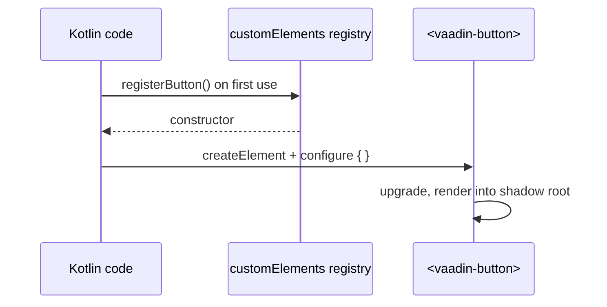

# Getting started

## 1. Add the dependency

Releases are on Maven Central under the `io.github.shijianjs` group:

```kotlin
dependencies {
    implementation("io.github.shijianjs:ktjs-vaadin-web-components:25.3.5-kt.8")
}
```

The module brings its npm half with it: the klib records the `@vaadin/*` versions it was built
against, so Kotlin/JS installs them next to your build without a second version line to maintain.

## 2. Target ES2015

Vaadin's components are real ES classes. A Kotlin/JS build below ES2015 emits
`function X() { HTMLElement.call(this) }`, which the DOM constructor rejects with *“Please use the
'new' operator”* — the page then fails on the first upgrade attempt. The setting lives on the **js
target**; passing `-target` as a free compiler argument does nothing.

```kotlin
kotlin {
    js {
        browser()
        compilerOptions {
            target = "es2015"
        }
    }
}
```

`jsMain` also needs `optIn.add("kotlin.js.ExperimentalWasmJsInterop")`: every upstream member
declared as `unknown` is modelled as `kotlin.js.JsAny`, and the compiler still marks that surface as
experimental.

## 3. Load the Lumo theme

The components render without a stylesheet, but they look unfinished: Lumo is what gives them their
spacing, colours and variants. Copy `lumo.css` and `utility.css` from
`node_modules/@vaadin/vaadin-lumo-styles` and link them in the page:

```html
<link rel="stylesheet" href="lumo.css">
<link rel="stylesheet" href="utility.css">
```

`utility.css` is what the `LumoUtility` objects reference; without it the utility classes resolve to
nothing. The demo copies both in its `copyLumoStyles` task.

## 4. Create a component

Each element has a `create<Name>(configure)` factory that registers the custom element on first use,
and a `VaadinTagName` constant when you build it as a tag:

```kotlin
import io.github.shijianjs.ktjs.vaadin.button.ButtonVariants
import io.github.shijianjs.ktjs.vaadin.button.createButton
import io.github.shijianjs.ktjs.vaadin.notification.createNotification
import io.github.shijianjs.ktjs.vaadin.themablemixin.addTheme

val button = createButton {
    textContent = "Save draft"
    // `theme` is a token list, not a string: adding a variant keeps the ones already set.
    addTheme(ButtonVariants.primary, ButtonVariants.small)
    addEventListener("click") {
        createNotification("Saved").open()
    }
}
```



## 5. Typed attributes instead of strings

Every element file ends with its typed attribute accessors. They read and write the **HTML
attribute**, so the markup, the JS property and the rendered node cannot disagree:

```kotlin
import io.github.shijianjs.ktjs.dom.attribute.Attribute
import io.github.shijianjs.ktjs.vaadin.card.cardTitleAttr
import io.github.shijianjs.ktjs.vaadin.card.createCard
import io.github.shijianjs.ktjs.vaadin.card.titleHeadingLevelAttr

val card = createCard()
card.cardTitleAttr.set("Quarterly report")
card.titleHeadingLevelAttr.set(3)
```

`Attribute<T>` is generic: `Attribute<String>`, `Attribute<Int>`, `Attribute<Boolean>`,
`Attribute<Double>`, `Attribute<TokenList>`. Decoding is the codec's job, so `titleHeadingLevelAttr`
returns an `Int` even though the attribute is text.

## 6. Icons

Vaadin ships an icon set of its own (`Icons`, rendered by `<vaadin-icon>`). Any other icon comes from
[Iconify](https://iconify.design/) through the official `iconify-icon` element:

```html
<iconify-icon icon="lucide:sparkles"></iconify-icon>
```

The Kotlin side of that element is the `ktjs-iconify` wrapper (`iconify-icon:3.0.x` in npm terms);
the demo uses it for every sidebar and button icon.

Next: [Components and capabilities](/guide/components).
