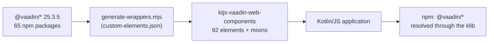

# ktjs-vaadin

Kotlin/JS wrappers for the free [Vaadin web components](https://github.com/vaadin/web-components).

**[Demo](https://shijianjs.github.io/ktjs-vaadin/demo/)** ·
**[API reference](https://shijianjs.github.io/ktjs-vaadin/api/)** ·
**[GitHub](https://github.com/shijianjs/ktjs-vaadin)**

Every free `@vaadin/*` package releases in lockstep from one upstream version, so they are wrapped in
a **single** Gradle module: `ktjs-vaadin-web-components`. 65 npm packages, 92 custom elements.

Keeping one module matters for more than tidiness: each module would otherwise need its own Maven
version, its own Central deployment and its own revision counter, while the only thing that changes
between them is a patch number. Tree shaking removes the declarations an application does not use.

## What a wrapper gives you

| Upstream | Here |
| --- | --- |
| `<vaadin-button>` tag | `VaadinTagName.button` / `createButton { }` |
| `ButtonElement` class | `external class ButtonElement : HTMLElement` |
| Attributes as strings | `ButtonElement.disabledAttr: Attribute<Boolean>` |
| `theme="primary small"` | `ButtonVariants.primary.addTo(button)` |
| Mixins (`ButtonMixin`, …) | `external interface` — a component is used through its capabilities |
| Lumo utility classes | `LumoUtility` objects (`LumoUtility.Padding.MEDIUM`) |

## Repository layout

| Directory | What it is |
| --- | --- |
| `ktjs-vaadin-web-components/` | the published wrapper module |
| `demo/` | the demo site (GitHub Pages `/demo/`), built on the shared demo kit |
| `docs/` | this site: Kotlin configuration + Markdown |
| `scripts/` | the generator that writes the wrapper from `custom-elements.json` |
| `scaffold/module/` | skeleton for a new module (not part of the build) |

## Versioning

`{upstream npm version}-kt.{revision}`, e.g. `25.3.5-kt.8`:

- the upstream version comes from the root [`package.json`](https://github.com/shijianjs/ktjs-vaadin/blob/master/package.json);
- the revision comes from `wrapper-revisions.properties` and only increases;
- only `-kt.N` versions are published — a version without the suffix never exists.

Next: [Getting started](/guide/getting-started).
