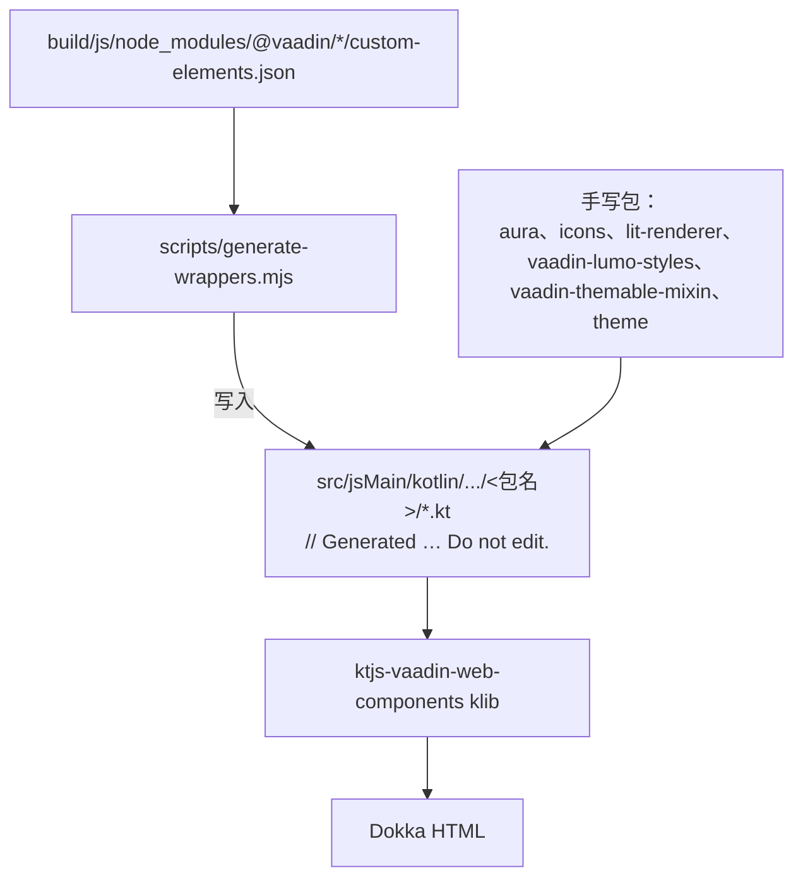

# API 文档与源码

发布的 Dokka 产物在 [shijianjs.github.io/ktjs-vaadin/api/](https://shijianjs.github.io/ktjs-vaadin/api/)，
它由带注解的源码生成，所以始终与 Maven Central 提供的内容一致。

## 生成与手写



- 生成文件以 `// Generated by scripts/generate-wrappers.mjs. Do not edit.` 开头，每次运行都会被删掉重写。
- 手写包列在生成器的 `HAND_WRITTEN` 集合里，永远不会被覆盖。它们出现在 manifest 写错或写得太薄的地方：
  `LoginI18n`、`UploadI18n`、`MenuBarI18n`、`DateTimePickerI18n`、`UploadManager` 等。
- manifest 能写对的一律保持生成。要改就改生成器，不要改产物。

## 上游升级后重新生成

```bash
# 1. 改 package.json 里的版本
./gradlew kotlinNpmInstall          # 安装新包，刷新 custom-elements.json
node scripts/generate-wrappers.mjs  # 重写生成的包
./gradlew :ktjs-vaadin-web-components:jsBrowserTest
```

## 刻意不建模的东西

| 缺口 | 原因 |
| --- | --- |
| 事件 `detail` 结构 | manifest 不记录；逐个手写 92 个 payload 等于猜 |
| 收费组件 | Board、Charts、CRUD、Dashboard、Grid Pro、Map、Rich Text Editor、Spreadsheet 不在免费包内 |
| React 绑定、`vaadin` / `vaadin-core` 元包 | 不是本库要暴露的东西 |
| `tree-grid` | V25 起它是 grid 的 tree column 加数据提供者，不再是独立自定义元素 |

仓库的 [`TODO.md`](https://github.com/shijianjs/ktjs-vaadin/blob/master/TODO.md) 保存着逐页覆盖表，
以及写 demo 时发现的 wrapper 问题清单。
