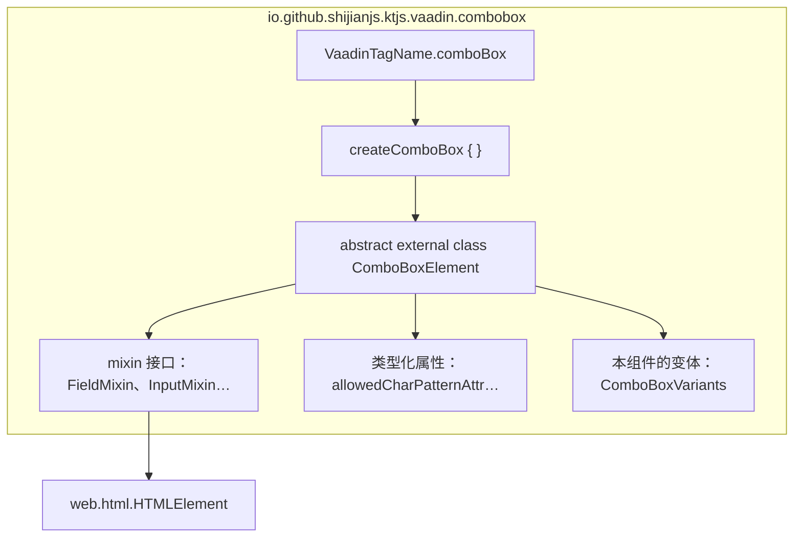

# 组件与能力

Wrapper 只有一条目录规则：**一个 npm 包对应一个 Kotlin 包**。npm 名去掉 `@vaadin/`、`vaadin-` 前缀和连字符，
`@vaadin/combo-box` 就是 `io.github.shijianjs.ktjs.vaadin.combobox`。



## 为什么 mixin 是接口

上游组件通过 mixin 共享行为（`FieldMixin`、`InputMixin`、`ThemePropertyMixin`、`FocusableMixin`…）。
每个 mixin 都是一个 `external interface`，每个元素实现它继承来的全部 mixin。效果是函数可以要求**能力**
而不是具体组件：

```kotlin
import io.github.shijianjs.ktjs.vaadin.fieldbase.FieldMixin

fun labelOf(field: FieldMixin): String = field.label
```

这和 Vaadin Flow 用 `HasValue` / `HasLabel` 表达的是同一件事，只是换成了你本来就有的接口。

## 类型化属性

每个元素文件末尾是它 HTML 属性的访问器。`Attribute<T>` 读写属性并通过 codec 解码，类型就是上游文档里
写的那个：

| 访问器 | 类型 |
| --- | --- |
| `cardTitleAttr` | `Attribute<String>` |
| `titleHeadingLevelAttr` | `Attribute<Int>` |
| `disabledAttr` | `Attribute<Boolean>` |
| `themeAttr` | `TokenListAttribute<ThemeVariant>` |

属性就是状态时用它——`Property` setter 和属性 setter 不等价：只有属性在 devtools 与服务端渲染的 HTML 里
看得见。

## 变体

`theme="primary small icon"` 是 token 列表，合法 token 是每个组件各自定义的。所以每个组件包拥有自己的
变体对象，类型是扩展共享 `ThemeVariant` 的 `sealed external interface`：

```kotlin
import io.github.shijianjs.ktjs.vaadin.button.ButtonVariants
import io.github.shijianjs.ktjs.vaadin.button.createButton
import io.github.shijianjs.ktjs.vaadin.themablemixin.addTheme
import io.github.shijianjs.ktjs.vaadin.themablemixin.hasTheme

val button = createButton()
button.addTheme(ButtonVariants.primary)          // 保留已设置的 token
button.removeTheme(ButtonVariants.primary)
check(button.hasTheme(ButtonVariants.small))
```

`addTheme` / `removeTheme` / `hasTheme` / `themes` 挂在 `ThemePropertyMixin` 上，而不是 `HTMLElement`：
只有真的会渲染 `theme` 属性的组件才实现它。

这些都只是同一个访问器 `themeAttr` 的简写：它是 `ktjs-wrapper-kit` 的
`TokenListAttribute<ThemeVariant>`，codec 把一个变体写成它的 `name`。所以属性对象本身也能用——
`themeAttr.add(ButtonVariants.primary)`、`themeAttr.tokens = listOf("acme-brand")`；`values`（类型化）和
`tokens`（原始字符串）是同一段文本的两个视图。类型化的 `add` / `remove` / `toggle` 不会丢掉原始 token，
只有 `setTheme(ThemeVariant…)` 会整体替换列表。

## 主题：Lumo 工具类

Lumo 的[工具类](https://vaadin.com/docs/latest/styling/lumo/utility-classes)被建模成 `ClassName` 对象，
于是 `padding` 是查出来的而不是敲出来的：

```kotlin
import io.github.shijianjs.ktjs.vaadin.card.createCard
import io.github.shijianjs.ktjs.vaadin.lumoutility.LumoUtility

val card = createCard()
card.classList.add(LumoUtility.Padding.MEDIUM, LumoUtility.Gap.SMALL)
```

`LumoUtility` 是一棵 `ClassName` 常量树，与 Flow 的 `LumoUtility` 类逐项对应，所以
`LumoUtility.AlignItems.Breakpoint.Small.CENTER` 就是 `sm:items-center`。

它们要求页面引入 `utility.css`（见[快速开始](/guide/getting-started)）。

## 事件

事件名沿用上游，payload 类型也沿用上游：manifest 不描述每个事件的 `detail`，所以除非 wrapper 手写了
payload 类型，事件到手时是 `web.events.Event`。payload 没有类型时，读组件状态——`value`、`selected`、
`opened`、原生 `inputElement.validity`——而不是读 payload。有具名 payload 的地方（upload、message list）
demo 直接用；已知缺口登记在仓库的 `TODO.md` 里。

## 页面在哪

每个组件都在 [demo](https://shijianjs.github.io/ktjs-vaadin/demo/) 里演示，分组口径与上游文档一致：

| 分组 | 页面 |
| --- | --- |
| 按钮与操作 | button、menu-bar |
| 输入字段 | text-field、text-area、email-field、password-field、number-field、integer-field、custom-field、field-highlighter |
| 选择控件 | checkbox、checkbox-group、radio-group、switch、select、combo-box、multi-select-combo-box、list-box、slider |
| 日期与时间 | date-picker、time-picker、date-time-picker |
| 浮层 | dialog、confirm-dialog、notification、popover、tooltip、context-menu、login |
| 数据 | grid、virtual-list、message-list、message-input、markdown、upload |
| 布局与导航 | app-layout、horizontal-layout、vertical-layout、form-layout、split-layout、scroller、master-detail-layout、card、accordion、details、tabs、tabsheet、side-nav、breadcrumbs |
| 基础展示 | avatar、avatar-group、badge、icon、icons、progress-bar |
| 主题与样式 | theming |
