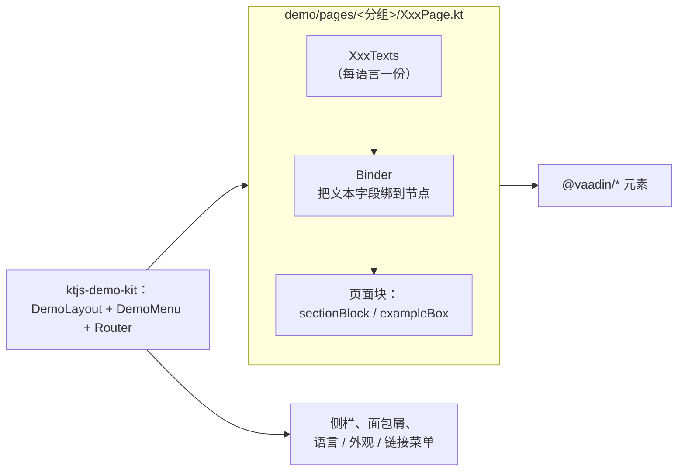
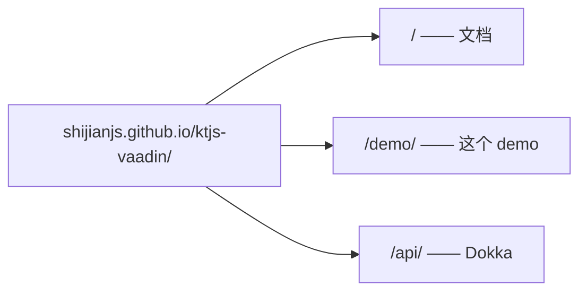

# 演示站点

demo 不是用完就扔的示例页，它是这个 wrapper 的集成测试。`demo/src/jsMain/kotlin/demo/pages/<分组>/`
下的每个组件页对应上游文档的一节，并且真的在调用 Kotlin API——如果某个示例非加强转就写不出来，
说明 wrapper 缺东西。



## 外壳提供了什么

外壳是 `ktjs-demo-kit`，本账号所有 demo 站点共用：

| 部件 | 作用 |
| --- | --- |
| `DemoLayout` | `vaadin-app-layout` + `vaadin-side-nav`，logo 与标题，三个 `vaadin-menu-bar`（文档 / 语言 / 外观） |
| `DemoMenu` | 分组、条目、图标；侧栏、面包屑、路由都由它推导 |
| `Router` | hash 路由（`#/button`），每个条目一个页面实例，切换路由时保留 |
| `LanguageState` | 已注册语言、持久化选择、对每个已挂载页调用 `applyTranslation` |
| `Theme` | 亮色 / 暗色 / 跟随浏览器，持久化，作为 `<html>` 的 `color-scheme` 生效 |

切换语言或外观从不重建页面：页面持有自己的节点，外壳只是遍历已挂载的那些。这就是页面必须实现
`applyTranslation(lang)`、并通过 `Binder` 绑定文案（而不是在构造时解析）的原因。

## 页面契约

```kotlin
internal class ButtonPage : Page {
    private val page = newPage()            // 标题、摘要、链接、正文
    private val texts = Binder(buttonTexts) // Translations<ButtonTexts>

    override val node get() = page

    init {
        val section = sectionBlock()
        texts.bind(section.title) { it.heading }
        section.body.append(texts.bind(paragraph()) { it.body })
        page.body.append(section.root)
    }

    override fun applyTranslation(lang: Lang) {
        val current = buttonTexts[lang]
        page.setTitle(current.title)
        page.setSummary(current.summary)
        texts.apply(lang)
    }
}
```

## 本地运行

```bash
# Kotlin/JS 开发服务器 + 热重载，http://localhost:8080/
./gradlew :demo:jsBrowserDevelopmentRun

# 生产包 + Playwright 端到端
./gradlew :demo:e2eTest
```

`e2eTest` 把截图写到 `demo/build/e2e-results/`，视觉状态就是这么看的：构建通过只说明能编译，不说明侧栏、
菜单和页面长得对。

## 部署在哪

`./gradlew pagesSite` 组装 GitHub Pages 目录：



因此 demo 的深链形如 `https://shijianjs.github.io/ktjs-vaadin/demo/#/button`。

下一步：[API 文档与源码](/guide/api-overview)。
