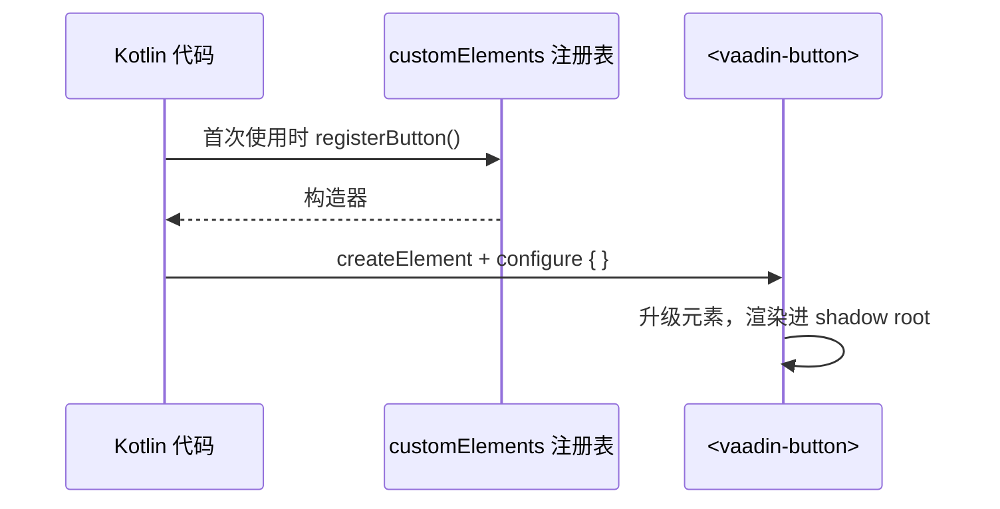

# 快速开始

## 1. 加依赖

发布产物在 Maven Central 的 `io.github.shijianjs` 组下：

```kotlin
dependencies {
    implementation("io.github.shijianjs:ktjs-vaadin-web-components:25.3.5-kt.8")
}
```

npm 那一半随模块一起来：klib 记录了它构建时的 `@vaadin/*` 版本，Kotlin/JS 会把这些包装进你的构建，
不需要再维护第二份版本号。

## 2. 目标设为 ES2015

Vaadin 组件是真正的 ES class。Kotlin/JS 低于 ES2015 的产物会发射
`function X() { HTMLElement.call(this) }`，DOM 构造器会以 *“Please use the 'new' operator”* 拒绝它，
页面在第一次升级元素时就报错。这个设置在 **js target** 上；用自由编译器参数传 `-target` 没有效果。

```kotlin
kotlin {
    js {
        browser()
        compilerOptions {
            target = "es2015"
        }
    }
}
```

`jsMain` 还需要 `optIn.add("kotlin.js.ExperimentalWasmJsInterop")`：上游所有声明为 `unknown` 的成员都被
建模成 `kotlin.js.JsAny`，编译器仍把这一面标成实验性的。

## 3. 引入 Lumo 主题

不引样式表组件也能渲染，只是看起来没做完：间距、颜色和变体都来自 Lumo。从
`node_modules/@vaadin/vaadin-lumo-styles` 复制 `lumo.css` 与 `utility.css`，在页面里引用：

```html
<link rel="stylesheet" href="lumo.css">
<link rel="stylesheet" href="utility.css">
```

`utility.css` 是 `LumoUtility` 引用的那套类，缺了它工具类解析不到任何规则。demo 的 `copyLumoStyles`
任务就是干这件事的。

## 4. 建一个组件

每个元素都有 `create<Name>(configure)` 工厂（首次使用时注册自定义元素），需要按标签建时用
`VaadinTagName` 常量：

```kotlin
import io.github.shijianjs.ktjs.vaadin.button.ButtonVariants
import io.github.shijianjs.ktjs.vaadin.button.createButton
import io.github.shijianjs.ktjs.vaadin.notification.createNotification
import io.github.shijianjs.ktjs.vaadin.themablemixin.addTheme

val button = createButton {
    textContent = "存草稿"
    // `theme` 是 token 列表而不是字符串：加一个变体不会冲掉已有的。
    addTheme(ButtonVariants.primary, ButtonVariants.small)
    addEventListener("click") {
        createNotification("已保存").open()
    }
}
```



## 5. 类型化属性，不写字符串

每个元素文件末尾是它的类型化属性访问器。它们读写的是**HTML 属性**，所以标记、JS 属性和渲染出的节点
不会互相矛盾：

```kotlin
import io.github.shijianjs.ktjs.dom.attribute.Attribute
import io.github.shijianjs.ktjs.vaadin.card.cardTitleAttr
import io.github.shijianjs.ktjs.vaadin.card.createCard
import io.github.shijianjs.ktjs.vaadin.card.titleHeadingLevelAttr

val card = createCard()
card.cardTitleAttr.set("季度报告")
card.titleHeadingLevelAttr.set(3)
```

`Attribute<T>` 是泛型的：`Attribute<String>`、`Attribute<Int>`、`Attribute<Boolean>`、`Attribute<Double>`、
`Attribute<TokenList>`。解码交给 codec，所以 `titleHeadingLevelAttr` 即便底层是文本也返回 `Int`。

## 6. 图标

Vaadin 自带一套图标（`Icons`，由 `<vaadin-icon>` 渲染）。其他图标来自
[Iconify](https://iconify.design/)，用的是官方 `iconify-icon` 元素：

```html
<iconify-icon icon="lucide:sparkles"></iconify-icon>
```

它在 Kotlin 侧对应 `ktjs-iconify` 这个 wrapper（npm 坐标 `iconify-icon:3.0.x`）；demo 的侧栏与按钮图标
全走它。

下一步：[组件与能力](/guide/components)。
