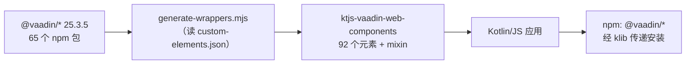

# ktjs-vaadin

免费版 [Vaadin Web Components](https://github.com/vaadin/web-components) 的 Kotlin/JS wrapper。

**[在线演示](https://shijianjs.github.io/ktjs-vaadin/demo/)** ·
**[API 文档](https://shijianjs.github.io/ktjs-vaadin/api/)** ·
**[GitHub](https://github.com/shijianjs/ktjs-vaadin)**

所有免费的 `@vaadin/*` 包按同一个上游版本同步发版，所以它们被包进**一个** Gradle 模块：
`ktjs-vaadin-web-components`。65 个 npm 包、92 个自定义元素。

合成一个模块不只为了整齐：拆开的话每个模块都要自己的 Maven 版本、一次 Central 部署和一个修订计数器，
而它们之间变动的只是一个补丁号。终端应用打包时本来就摇树，没用到的声明不会进入产物。

## wrapper 给了什么

| 上游 | 这里 |
| --- | --- |
| `<vaadin-button>` 标签 | `VaadinTagName.button` / `createButton { }` |
| `ButtonElement` 类 | `external class ButtonElement : HTMLElement` |
| 属性都是字符串 | `ButtonElement.disabledAttr: Attribute<Boolean>` |
| `theme="primary small"` | `ButtonVariants.primary.addTo(button)` |
| mixin（`ButtonMixin` 等） | `external interface`——按能力使用组件 |
| Lumo 工具类 | `LumoUtility` 对象（`LumoUtility.Padding.MEDIUM`） |

## 仓库结构

| 目录 | 是什么 |
| --- | --- |
| `ktjs-vaadin-web-components/` | 发布的 wrapper 模块 |
| `demo/` | 演示站点（GitHub Pages 的 `/demo/`），基于共用的 demo kit |
| `docs/` | 本站：Kotlin 配置 + Markdown |
| `scripts/` | 从 `custom-elements.json` 生成 wrapper 的脚本 |
| `scaffold/module/` | 新模块的骨架（不参与构建） |

## 版本口径

`{上游 npm 版本}-kt.{修订号}`，例如 `25.3.5-kt.8`：

- 上游版本取自根目录 [`package.json`](https://github.com/shijianjs/ktjs-vaadin/blob/master/package.json)；
- 修订号取自 `wrapper-revisions.properties`，只增不减；
- 只发布 `-kt.N` 版本，不带后缀的版本从不发布。

下一步：[快速开始](/guide/getting-started)。
